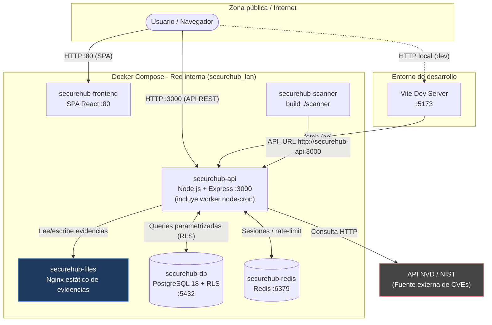
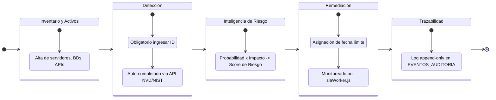
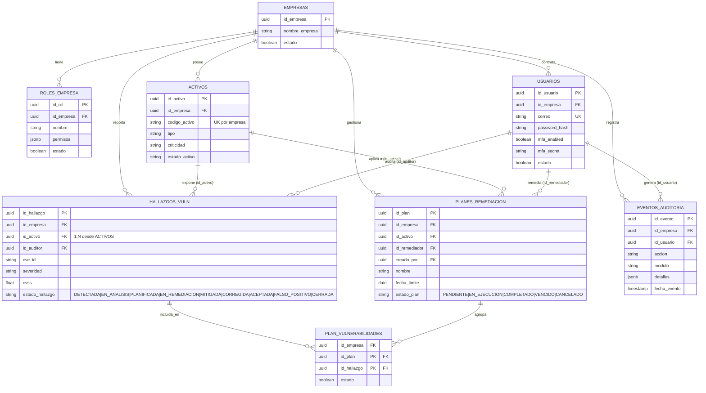
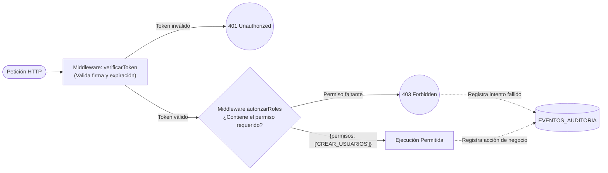

# VulnTrack — Plataforma DevSecOps de Gestión Integral de Vulnerabilidades (VAM)


> Desarrollado por el equipo de Seguridad y DevSecOps.

**VulnTrack** es una plataforma para el seguimiento y remediación de vulnerabilidades informáticas, orientada a entornos corporativos **multi-tenant**. No es un antivirus ni un escáner estático: es el panel centralizado que unifica el inventario de activos, los hallazgos de seguridad (enriquecidos automáticamente desde la base nacional de vulnerabilidades del NIST/NVD), el análisis de riesgo y los planes de remediación con SLAs monitoreados de forma automatizada.

El flujo operativo sigue una secuencia estricta:

**[Inventario y Detección] → [Cálculo de Riesgo / Inteligencia] → [Remediación y Cierre]**

> **Nota del mantenedor**: El logo superior es el placeholder por defecto de Vite. Reemplázalo por un banner propio antes de publicar el repositorio en producción.

---

## Tabla de contenidos

1. [Stack Tecnológico](#stack-tecnológico)
2. [Arquitectura del Sistema](#arquitectura-del-sistema)
3. [Flujo Operativo y de Negocio](#flujo-operativo-y-de-negocio)
4. [Modelo Relacional de Datos (ERD)](#modelo-relacional-de-datos-erd)
5. [Control de Acceso Basado en Permisos (RBAC Dinámico)](#control-de-acceso-basado-en-permisos-rbac-dinámico)
6. [Prerrequisitos](#prerrequisitos)
7. [Variables de Entorno](#variables-de-entorno)
8. [Instrucciones de Despliegue Local](#instrucciones-de-despliegue-local)
9. [Solución de Problemas Comunes](#solución-de-problemas-comunes)
10. [Cuentas de Prueba](#cuentas-de-prueba)
11. [Postura de Seguridad y Checklist OWASP](#postura-de-seguridad-y-checklist-owasp)

---

## Stack Tecnológico

Los nombres entre paréntesis corresponden a los servicios reales definidos en `docker-compose.yml`.

| Capa | Tecnología | Servicio compose | Rol en el proyecto |
|---|---|---|---|
| Frontend | React + Vite, Tailwind CSS, Lucide React | `securehub-frontend` (`:80`) | SPA publicada directamente en el puerto `80`; hot-reload en desarrollo con Vite, build optimizado en producción. |
| Backend | Node.js + Express | `securehub-api` (`:3000`) | API REST, lógica de negocio y enrutamiento. |
| Base de datos | PostgreSQL 18 (`postgres:18.6-alpine`) | `securehub-db` | Datos relacionales y **Row-Level Security (RLS)** para aislamiento estricto multi-tenant. |
| Caché / Mensajería | Redis 7 | `securehub-redis` | Almacenamiento rápido de sesiones y contadores del rate-limiting anti fuerza bruta del login (`middlewares/rateLimitLogin.js`), con degradación *fail-open* si Redis no está disponible. |
| Servidor de evidencias | Nginx (`nginx:alpine`) | `securehub-files` | Sirve **únicamente** las evidencias estáticas (volumen `files-data` montado en `/usr/share/nginx/html/evidencias`). Según `config/nginx.conf` solo permite `GET`/`HEAD` sin listado de directorios. **No** termina TLS ni actúa como reverse proxy que enrute la API. |
| Escáner | Imagen propia (`build ./scanner`) | `securehub-scanner` | Proceso que consulta la API vía `API_URL=http://securehub-api:3000` para su trabajo de escaneo. |
| Automatización | `node-cron` | *(hilo interno de `securehub-api`)* | Hilo asíncrono integrado (`slaWorker.js`) para el monitoreo automatizado de vencimientos de SLA. No es un contenedor separado. |
| Autenticación | `jsonwebtoken`, `bcryptjs`, `speakeasy` + `qrcode` | *(parte de `securehub-api`)* | JWT stateless, hashing robusto de contraseñas con salt automático, MFA/TOTP compatible con Google Authenticator. |
| Contenerización | Docker + Docker Compose | — | Orquestación local de todos los servicios anteriores. |

---

## Arquitectura del Sistema

La arquitectura aísla completamente a las empresas a nivel de base de datos mediante RLS (Row Level Security). Las tareas asíncronas se gestionan mediante un hilo `node-cron` integrado en la propia API (no hay contenedor de worker separado). El cliente accede **directamente** a dos servicios expuestos: el frontend en el puerto `80` (`securehub-frontend`) y la API en el puerto `3000` (`securehub-api`). No existe un reverse proxy que termine TLS ni que enrute la API; el servicio Nginx (`securehub-files`) solo sirve evidencias estáticas dentro de la red interna.



> **Endpoint de salud:** `GET /health` responde `{ status: 'OK', servicio: 'SecureHub API', version: '1.0.0' }`, útil para healthchecks y verificación rápida de que la API está en línea.

---

## Flujo Operativo y de Negocio



---

## Modelo Relacional de Datos (ERD)

VulnTrack aísla de forma matemática a las empresas utilizando **Políticas RLS en PostgreSQL**: toda tabla de negocio cuelga de `EMPRESAS` mediante `id_empresa`. Además, cuenta con una tabla de roles dinámica por inquilino. Cada activo expone sus hallazgos (relación 1:N vía `id_activo`), y un plan de remediación agrupa una o varias vulnerabilidades a través de la tabla puente `PLAN_VULNERABILIDADES` (M:N), reemplazando el antiguo vínculo 1:1 `planes_remediacion.id_hallazgo`.



---

## Control de Acceso Basado en Permisos (RBAC Dinámico)

A diferencia de los sistemas tradicionales, VulnTrack no utiliza roles "quemados" (hardcoded). Implementa un motor dinámico:
1. El Administrador crea roles personalizados y les asigna permisos granulares (JSONB) en la tabla `roles_empresa`.
2. Al iniciar sesión, la matriz de permisos se empaqueta criptográficamente en el JWT.
3. El middleware en Node.js valida la existencia del permiso exacto antes de permitir la ejecución.



---

## Prerrequisitos

Antes de clonar, verifica tener instaladas las siguientes herramientas:

| Herramienta | Comando de verificación | Notas |
|---|---|---|
| Docker | `docker --version` | Necesario para levantar DB, Redis y API localmente. |
| Docker Compose | `docker-compose version` | Verifica tu versión (standalone o plugin). |
| Node.js | `node -v` | (v18+) Necesario para correr el frontend (`npm run dev`). |
| Puertos | Verificar `3000`, `5432`, `5173` libres | Libera los puertos locales si tienes otros proyectos activos. |

---

## Variables de Entorno

Debes crear un archivo `.env` en la **raíz del proyecto** (junto a `docker-compose.yml`), partiendo de la plantilla `.env.example` incluida en esa misma raíz.

| Variable | Propósito | Notas de seguridad |
|---|---|---|
| `DB_HOST`, `DB_USER` | Credenciales del superusuario de la DB | El superusuario crea la base; evita usarlo para la operación normal de la API. |
| `DB_APP_USER` | Cuenta de bajo privilegio que usa la API | Debe existir en `init.sql`. Garantiza que las políticas RLS apliquen; sin permisos para crear/eliminar tablas. |
| `DB_APP_PASSWORD` | Contraseña de la cuenta `DB_APP_USER` | Nunca hardcodear. Distinta de la del superusuario. |
| `CORS_ORIGINS` | Lista CSV de orígenes permitidos por CORS | En producción, restringir a los dominios reales del frontend (p. ej. `http://localhost:5173,http://localhost`). |
| `REDIS_HOST` | Host del contenedor Redis | En docker-compose apunta al servicio `securehub-redis`. |
| `JWT_SECRET` | Firma criptográfica JWT | Nunca hardcodear en código fuente. Usar una cadena larga y aleatoria. |
| `NVD_API_KEY` | API Key de NIST (Opcional) | Evita bloqueos por Rate-Limit en la ingesta de CVEs. |

---

# 🚀 VulnTrack — Guía de despliegue local

Esta guía explica cómo instalar y ejecutar **VulnTrack** en un computador con Windows utilizando Docker Compose y PostgreSQL.

## 1. Información del proyecto

- **Repositorio:** [VulnTrack en GitHub](https://github.com/3D74R08/VulnTrack)
- **Rama:** `main`
- **Frontend:** http://localhost:5173
- **API:** http://localhost:3000
- **Grafana:** [Dashboard de monitorización](http://localhost:3001/d/adl6rln/vulntrack-monitorizacion-de-infraestructur?orgId=1&from=now-6h&to=now&timezone=browser)
- **Prometheus:** http://localhost:9090
- **Reglas de Prometheus:** http://localhost:9090/rules
- **Alertas de Prometheus:** http://localhost:9090/alerts

## 2. Requisitos previos

Antes de comenzar, instala:

- Git para Windows.
- Docker Desktop.
- Docker Compose, incluido en Docker Desktop.
- Node.js y npm, únicamente si ejecutarás el frontend directamente desde Windows.

Abre Docker Desktop y verifica que esté funcionando.

## 3. Descargar el proyecto

Abre PowerShell y ejecuta:

```powershell
git clone https://github.com/3D74R08/VulnTrack.git
cd VulnTrack
```

El repositorio se descargará en una carpeta llamada `VulnTrack`.

## 4. Configurar las variables de entorno

En la raíz del proyecto, crea el archivo `.env` a partir de `.env.example`:

```powershell
Copy-Item .env.example .env
```

Abre `.env` y configura los valores necesarios para tu entorno.

**Importante:**
- El archivo `.env` contiene configuración privada y no debe subirse a GitHub.
- El archivo `.env.example` sí puede publicarse, siempre que no contenga credenciales reales.
- Si el proyecto necesita una copia de seguridad de PostgreSQL, debes obtenerla por un medio seguro y restaurarla según el procedimiento del proyecto.

## 5. Iniciar VulnTrack

Desde la raíz del proyecto, ejecuta:

```powershell
docker compose up -d --build
```

Este comando construye las imágenes necesarias e inicia los servicios definidos en Docker Compose.

Una vez iniciados, abre el frontend:

http://localhost:5173

La API y las herramientas de monitorización estarán disponibles en sus respectivas direcciones cuando sus servicios estén funcionando.

## 6. Ejecutar el frontend por separado (opcional)

desde la terminal de git bash ejecuta el siguiente comando:

```powershell
cd frontend
npm install
```

Si prefieres ejecutar el frontend directamente desde Windows en lugar de usar su contenedor, abre otra terminal de PowerShell y ejecuta:

```powershell
cd frontend
npm.cmd run dev
```

Después, abre http://localhost:5173.

No ejecutes esta opción si el frontend ya está funcionando en el mismo puerto mediante Docker.

## 7. Acceso a la aplicación

Utiliza las credenciales de prueba proporcionadas para el entorno local.

Por seguridad, no publiques contraseñas reales en el README ni en repositorios públicos. Entrega las credenciales mediante un canal privado.

## 8. Detener los servicios

Para detener VulnTrack sin eliminar los datos persistentes:

```powershell
docker compose down
```

Para volver a iniciar los servicios, utiliza el comando de inicio indicado en la sección 5.

## ✅ Verificación final

Antes de dar por terminada la instalación, comprueba que:

- Docker Desktop esté funcionando.
- Los servicios de Docker Compose se hayan iniciado correctamente.
- La base de datos esté disponible y tenga los datos requeridos.
- El frontend y la API respondan.
- Grafana y Prometheus estén disponibles si forman parte del despliegue.

**Nota:** la disponibilidad de los servicios depende de la configuración de Docker Compose, las variables de entorno y la inicialización de la base de datos.

## 8. Seguridad y mantenimiento

- No subir `.env`, contraseñas, tokens ni archivos `.dump` a GitHub.
- Mantener una copia de seguridad privada de la base de datos.
- Verificar el respaldo antes de utilizarlo para una restauración.
- Cambiar las credenciales de prueba antes de desplegar el sistema en un entorno real.
- No ejecutar restauraciones destructivas sobre una base de datos que contenga información que deba conservarse.
- Mantener actualizadas las dependencias y revisar los registros cuando un servicio no inicie.
- Utilizar credenciales diferentes para desarrollo, pruebas y producción.

---

## 9. Resultado esperado

Al completar este procedimiento, VulnTrack debe estar ejecutándose en el segundo computador con sus servicios configurados, el frontend accesible y, si se restauró correctamente la copia de seguridad, los usuarios, las empresas y los demás registros que existían en el computador original.

La restauración de datos y el despliegue de la aplicación son operaciones independientes: clonar el repositorio no recupera automáticamente la base de datos.


## Solución de Problemas Comunes

| Síntoma | Causa probable | Solución |
|---|---|---|
| Crash `pool.connect is not a function` en logs del API | La destructuración del archivo `db.js` falló en el SLA worker. | (Ya resuelto en v1.1). Verificar que se importa usando `const { pool } = require(...)`. |
| Menú de "Rol Inicial" aparece vacío | Faltan permisos de base de datos para la tabla `roles_empresa`. | Ejecutar `GRANT ALL PRIVILEGES ON TABLE roles_empresa TO app_user;` en PostgreSQL. |
| "Objects are not valid as a React child" en el Dashboard | Se intentó renderizar un JSON puro (la columna `detalles`) en React. | (Ya resuelto). Se debe mapear `notif.accion` en la interfaz. |
| Cierre de sesión (Logout) bloqueado | Política de MFA forzado. | Se debe escanear el QR e ingresar el PIN al menos una vez para habilitar la salida. |

---

**Nota de Seguridad (MFA):** Durante el primer inicio de sesión, el doble factor estará inactivo. El sistema forzará de manera estricta la configuración del MFA en cuanto el usuario intente desloguearse (Cerrar Sesión).

---

## Postura de Seguridad y Checklist OWASP

Este proyecto nace bajo un enfoque *Security-by-Design*:

| Categoría OWASP Top 10 (2021) | Contramedida Implementada y Verificada |
|---|---|
| **A01 – Broken Access Control** | RLS activo en Postgres; Middleware de permisos dinámicos en Node; Soft-Deletes. |
| **A02 – Cryptographic Failures** | `bcryptjs` con generador de sal automático para credenciales. JWT firmado correctamente. |
| **A03 – Injection** | Consultas estrictamente parametrizadas con `pg`. Prevención absoluta de SQLi. |
| **A04 – Insecure Design** | El `app_user` no tiene permisos para crear/eliminar tablas. Modelo Multi-tenant rígido. |
| **A05 – Security Misconfiguration** | `helmet` para cabeceras seguras; CORS restringido por lista blanca (`CORS_ORIGINS`); `trust proxy` para resolver la IP real del cliente; límite de payload JSON (`10kb`). |
| **A07 – Auth Failures** | Expiración de JWT. Imposición mandatoria de MFA (TOTP) al salir. Rate-limiting anti fuerza bruta en `POST /api/auth/login` (por IP e IP+correo) respaldado por Redis. |
| **A09 – Security Logging** | Tabla inmutable `EVENTOS_AUDITORIA` que registra intentos exitosos, creaciones, 401 y 403. |


## 7. 📊 Configuración de Grafana y Prometheus

VulnTrack utiliza Prometheus para recopilar métricas de la API y Grafana para visualizarlas mediante un dashboard de monitorización.

### 7.1. Acceder a Grafana

1. Inicia los servicios de VulnTrack mediante Docker Compose.
2. Abre Grafana en el navegador: [http://localhost:3001](http://localhost:3001).
3. Inicia sesión con las credenciales configuradas para tu entorno.
4. En el menú lateral, entra a **Connections → Data sources**.
5. Selecciona **Add data source** y elige **Prometheus**.
6. En el campo **Prometheus server URL**, introduce la dirección correspondiente a tu despliegue:
   - **Docker Compose:** utiliza la URL interna del servicio Prometheus, por ejemplo `http://prometheus:9090`, si ese es el nombre del servicio y ambos contenedores comparten una red.
   - **Ejecución directa en Windows:** utiliza `http://localhost:9090`.
7. Pulsa **Save & test** y verifica que la conexión sea correcta.

> **Nota:** dentro de un contenedor, `localhost` hace referencia al propio contenedor. Por eso, Grafana normalmente debe conectarse a Prometheus mediante el nombre de su servicio en Docker Compose.

### 7.2. Crear el dashboard

1. En el menú lateral, selecciona **Dashboards**.
2. Pulsa **New → New dashboard**.
3. Selecciona **Add visualization**.
4. Elige la fuente de datos de Prometheus.
5. Introduce la consulta PromQL correspondiente.
6. Configura el nombre y el tipo de visualización del panel.
7. Pulsa **Apply** para añadirlo al dashboard.
8. Repite los pasos para cada una de las cuatro métricas.
9. Al terminar, pulsa **Save dashboard** y asigna el nombre `VulnTrack - Monitorización de API`.

### 7.3. Panel 1: Disponibilidad de la API

**Nombre:** Disponibilidad de la API

**Consulta PromQL:**

```promql
up{job="vulntrack-api"}
```

**Visualización recomendada:** Stat.

Esta métrica indica si Prometheus puede recopilar métricas del objetivo de la API:

- `1`: objetivo accesible para Prometheus.
- `0`: objetivo inaccesible o fallo al recopilar métricas.

Configura los valores para que el panel permita distinguir fácilmente entre disponibilidad y fallo.

### 7.4. Panel 2: Memoria utilizada por la API (MB)

**Nombre:** Memoria utilizada por la API (MB)

**Consulta PromQL:**

```promql
process_resident_memory_bytes{job="vulntrack-api"} / 1024 / 1024
```

**Visualización recomendada:** Time series.

La consulta convierte la memoria residente del proceso de bytes a megabytes.

En las opciones del panel, configura la unidad de visualización como **megabytes (MB)**. Así podrás observar cómo cambia el consumo de memoria de la API a lo largo del tiempo.

### 7.5. Panel 3: Peticiones HTTP por segundo

**Nombre:** Peticiones HTTP por segundo

**Consulta PromQL:**

```promql
sum(rate(vulntrack_http_requests_total[3m]))
```

**Visualización recomendada:** Time series.

Esta consulta calcula la tasa agregada de peticiones HTTP por segundo durante una ventana de tres minutos.

La métrica `vulntrack_http_requests_total` debe ser un contador acumulativo de solicitudes HTTP. La visualización permite observar los cambios en el tráfico de la API.

### 7.6. Panel 4: Latencia media HTTP (segundos)

**Nombre:** Latencia media HTTP (segundos)

**Consulta PromQL:**

```promql
sum(rate(vulntrack_http_request_duration_seconds_sum[3m]))
/
sum(rate(vulntrack_http_request_duration_seconds_count[3m]))
```

**Visualización recomendada:** Time series.

Esta consulta calcula la duración media de las solicitudes HTTP durante una ventana de tres minutos, dividiendo la tasa acumulada de duración entre la tasa de solicitudes observadas.

Configura la unidad del panel como **seconds (s)** para visualizar la latencia en segundos.

> **Nota:** esta consulta requiere que la API exponga las métricas `vulntrack_http_request_duration_seconds_sum` y `vulntrack_http_request_duration_seconds_count`. Si no hay solicitudes registradas en la ventana, el resultado puede no estar disponible.

### 7.7. Validar las métricas

Si los paneles no muestran datos, realiza estas comprobaciones:

1. Abre [Prometheus Targets](http://localhost:9090/targets) y verifica que el objetivo `vulntrack-api` esté en estado `UP`.
2. Confirma que Grafana tenga configurada correctamente la fuente de datos de Prometheus.
3. Verifica que las métricas utilizadas en las consultas estén disponibles en Prometheus.
4. Comprueba que el nombre del trabajo sea exactamente `vulntrack-api`.
5. Asegúrate de que exista actividad reciente de la API y selecciona un rango de tiempo apropiado en Grafana.

### 7.8. Resultado esperado

El dashboard de VulnTrack debe mostrar cuatro paneles:

| Panel | Métrica | Visualización |
|---|---|---|
| Disponibilidad de la API | Estado del objetivo de Prometheus | Stat |
| Memoria utilizada por la API (MB) | Memoria residente del proceso | Time series |
| Peticiones HTTP por segundo | Tasa de solicitudes HTTP | Time series |
| Latencia media HTTP (segundos) | Duración media de las solicitudes | Time series |

Estas visualizaciones permiten observar la disponibilidad del objetivo, el consumo de memoria, el volumen de solicitudes y la latencia media de la API.

