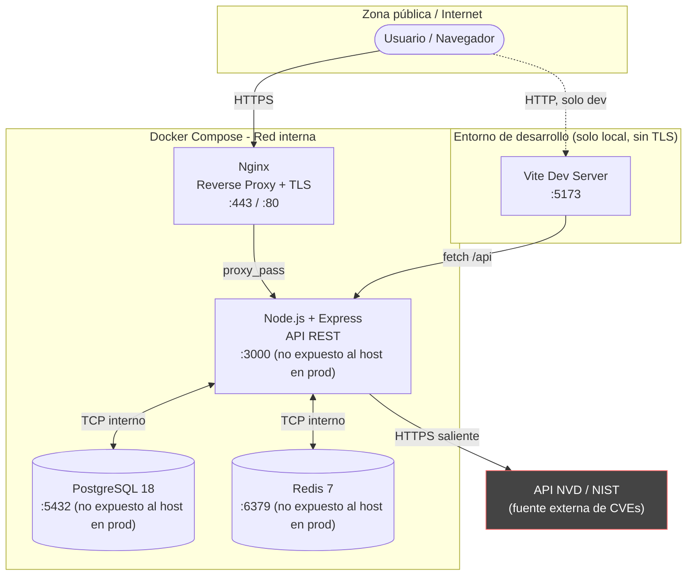
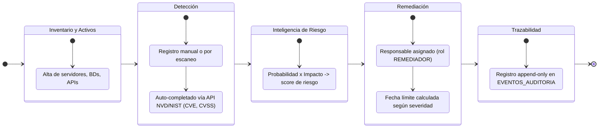
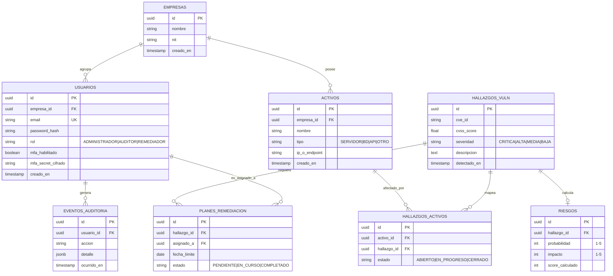
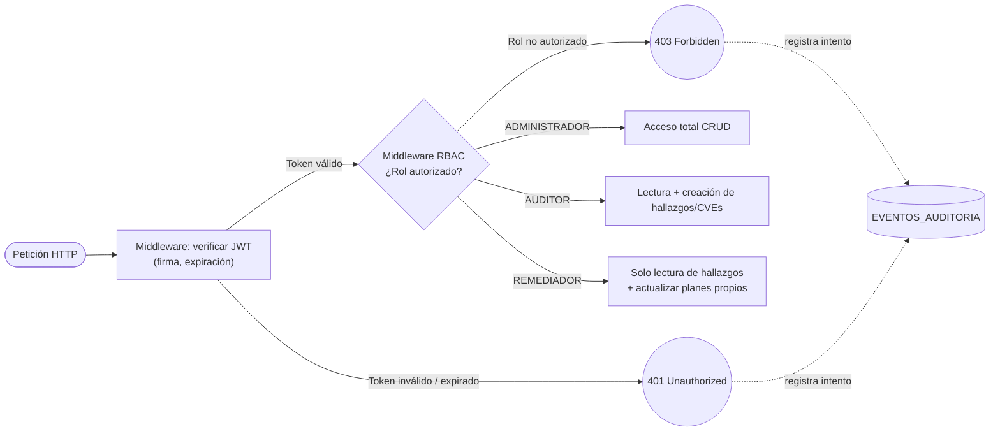

# VulnTrack - Plataforma de Gestión Integral de Vulnerabilidades (VAM)


> Desarrollado por el equipo de Seguridad y DevSecOps.

**VulnTrack** no es simplemente un antivirus o un escáner estático; es el "cerebro" centralizado de la ciberseguridad corporativa. Esta plataforma unifica la gestión de activos, el descubrimiento de vulnerabilidades, la inteligencia de riesgos y el ciclo de remediación en un solo panel de control unificado.

Nuestra filosofía sigue un flujo operativo estricto: **[Inventario y Detección] ➔ [Cálculo de Riesgo / Inteligencia] ➔ [Remediación y Cierre]**.

> ⚠️ **Nota del mantenedor de este README**: el logo de arriba es el placeholder por defecto de Vite (`./frontend/public/vite.svg`). Reemplázalo por un banner propio del proyecto antes de publicar el repo — un logo de la herramienta de build no comunica nada sobre VulnTrack.

---

## Tabla de contenidos

1. [Arquitectura del sistema](#-arquitectura-del-sistema)
2. [Stack tecnológico](#-stack-tecnológico-tech-stack)
3. [Flujo operativo y de negocio](#-flujo-operativo-y-de-negocio)
4. [Modelo relacional de datos (ERD)](#️-modelo-relacional-de-datos-erd)
5. [Control de acceso basado en roles (RBAC)](#-control-de-acceso-basado-en-roles-rbac)
6. [Variables de entorno](#-variables-de-entorno)
7. [Instrucciones de despliegue local](#-instrucciones-de-despliegue-local)
8. [Cuentas de prueba](#-cuentas-de-prueba)
9. [Postura de seguridad y checklist OWASP](#️-postura-de-seguridad-y-checklist-owasp)

---

## 🏗 Arquitectura del Sistema

El proyecto sigue una arquitectura orientada a microservicios dentro de un ecosistema Dockerizado. El diagrama separa explícitamente la **red pública** de la **red interna de Docker Compose**: en producción, solo Nginx debe exponer puertos al host — API, base de datos y Redis quedan aislados en la red interna del contenedor.



**Por qué importa esta separación:** si Postgres o Redis quedan mapeados a puertos del host (`ports: ["5432:5432"]` en el `docker-compose.yml`), cualquier proceso en la máquina —o en la red, si el host tiene una IP accesible— puede intentar conectarse directamente a la base de datos sin pasar por la API ni por el middleware RBAC. Usa `expose` en lugar de `ports` para los servicios internos, y reserva `ports` solo para Nginx.

### 💻 Stack Tecnológico (Tech Stack)

#### Frontend
*   **React 18 + Vite**: entorno de desarrollo ultrarrápido (Hot-Reload) y empaquetado optimizado para producción.
*   **Tailwind CSS**: framework utilitario para un diseño oscuro, limpio y responsivo, basado en los mockups de *SecureHub*.
*   **Recharts**: renderiza gráficos dinámicos (tendencias, matrices de calor, SLA donuts) en tiempo real.
*   **Lucide React**: iconografía ligera y consistente enfocada en paneles de seguridad.

#### Backend
*   **Node.js + Express.js**: capa API RESTful encargada de la lógica de negocio y enrutamiento.
*   **PostgreSQL 18**: base de datos relacional estricta. Usa `UUID`, `CHECK constraints` para consistencia de datos (severidades limitadas a `CRITICA`, `ALTA`, etc.) y soporta Row-Level Security (RLS) multi-tenant.
*   **Redis 7**: almacenamiento de sesiones rápidas y base para el futuro Background Worker (colas de tareas).
*   **Nginx**: proxy reverso, sirve estáticos en producción y termina TLS.
*   **Seguridad**:
    *   `jsonwebtoken` y `bcryptjs` — autenticación stateless y hashing de contraseñas.
    *   `speakeasy` y `qrcode` — motor 2FA/MFA con TOTP compatible con Google Authenticator.

> **No tengo información verificada sobre las versiones mínimas exactas de `jsonwebtoken`, `bcryptjs`, `speakeasy` o `qrcode` usadas en este proyecto.** Documenta las versiones reales directamente desde `package.json` (o fíjalas con `npm ls <paquete>`) en lugar de asumir una versión — así el README no queda desincronizado del `package-lock.json` real.

---

## 🔄 Flujo Operativo y de Negocio

El sistema está diseñado para que los equipos de seguridad no trabajen en silos. El ciclo de vida de un hallazgo:



**Nota de diseño:** para que "Trazabilidad" sirva realmente en una auditoría ISO 27001, la tabla `EVENTOS_AUDITORIA` debe ser append-only a nivel de base de datos (sin `UPDATE`/`DELETE` permitidos vía permisos de rol de Postgres o triggers que los bloqueen), no solo por convención de la aplicación. Si la API es la única barrera, cualquier acceso directo a la BD (o un bug de inyección SQL) podría alterar el log de auditoría.

---

## 🛡️ Modelo Relacional de Datos (ERD)

El ERD original documentaba relaciones pero no atributos, lo cual limita su utilidad para una auditoría de datos. Abajo se agregan columnas representativas basadas en lo descrito en este README (UUIDs, roles, severidades con `CHECK constraints`).

> **No tengo información verificada del esquema real de tu base de datos.** Estas columnas son una propuesta de referencia — ajústalas a las migraciones reales antes de tratarlas como documentación autoritativa.



**Detalle importante que sí puedes verificar tú mismo:** `password_hash` nunca debe almacenar el hash con un salt fijo o global — `bcryptjs` genera un salt por registro automáticamente si usas `bcrypt.hash(password, saltRounds)` correctamente; confirma que no exista un helper propio que reutilice un salt fijo en el código (sería una falla criptográfica real, OWASP A02:2021).

---

## 🔒 Control de Acceso Basado en Roles (RBAC)

VulnTrack implementa un middleware estricto que protege los endpoints a nivel de backend, no solo ocultando botones en el frontend. El diagrama separa dos fallos distintos — token inválido (401) y rol no autorizado (403) — porque tratarlos igual dificulta el diagnóstico en producción y en pentests.



**Por qué registrar los 401/403:** un middleware RBAC que solo responde con el código HTTP y no deja rastro es un punto ciego típico. Si alguien intenta escalar privilegios probando rutas con un token de `REMEDIADOR`, quieres esa evidencia en `EVENTOS_AUDITORIA`, no solo en los logs efímeros de Nginx.

---

## 🔧 Variables de Entorno

> Los nombres siguientes son **orientativos**, no confirmados contra tu código — no tengo visibilidad del `.env.example` real del proyecto. Ajusta las claves a las que efectivamente lea tu aplicación (`process.env.X`).

| Variable | Propósito | Notas de seguridad |
|---|---|---|
| `DATABASE_URL` | Cadena de conexión a PostgreSQL | Nunca la hardcodees en el código ni la subas al repo |
| `REDIS_URL` | Cadena de conexión a Redis | Igual que arriba |
| `JWT_SECRET` | Firma de tokens JWT | Mínimo 256 bits de entropía; rota periódicamente |
| `JWT_EXPIRES_IN` | Expiración del access token | Prefiere vidas cortas (ej. 15 min) + refresh token |
| `NVD_API_KEY` | Autenticación contra la API de NVD/NIST | Solicítala en [nvd.nist.gov](https://nvd.nist.gov/developers/request-an-api-key) para evitar rate limiting agresivo |
| `MFA_ISSUER_NAME` | Nombre mostrado en el Authenticator | No sensible |

Copia siempre un `.env.example` sin valores reales al repo, y añade `.env` a `.gitignore`. Si `.env` ya fue commiteado alguna vez, rota **todas** las credenciales que contenía — quitarlo del último commit no lo borra del historial de git.

---

## 🛠 Instrucciones de Despliegue Local

1. **Clonar el repositorio y entrar a la raíz:**
   ```bash
   git clone <repo-url> VulnTrack
   cd VulnTrack
   ```

2. **Configurar variables de entorno:**
   ```bash
   cp .env.example .env
   # Edita .env con tus valores locales antes de continuar
   ```

3. **Levantar la infraestructura base (Docker):**
   ```bash
   docker-compose up -d --build
   ```
   Esto aprovisiona la base de datos, Redis y la API. En producción, expón solo Nginx al host (ver sección de arquitectura); en desarrollo local está bien exponer `3000` temporalmente para depurar.

4. **Iniciar el entorno de desarrollo frontend (Hot-Reload):**
   ```bash
   cd frontend
   npm install
   npm run dev
   ```
   Abre el panel centralizado en: `http://localhost:5173`

---

## 🔑 Cuentas de Prueba

La base de datos de pruebas se puebla con tres roles para validar los bloqueos y permisos RBAC:

| Rol | Permisos |
|---|---|
| `ADMINISTRADOR` | Acceso total a todos los módulos |
| `AUDITOR` | Creación de vulnerabilidades y evaluación de riesgo |
| `REMEDIADOR` | Solo lectura de vulnerabilidades, acceso a planes de acción propios |

Las credenciales **no se documentan en este README** — genera usuarios de prueba con contraseñas únicas por rol ejecutando el script de seed de tu proyecto (revisa el comando exacto en `package.json`, ya que no tengo esa información verificada) y consúltalas desde tu gestor de secretos local o el propio `.env` de desarrollo. Publicar contraseñas de prueba en un repositorio —y más aún, reutilizar la misma contraseña del Administrador para otros roles— facilita el movimiento lateral si ese entorno se filtra o se despliega accidentalmente accesible desde fuera.

*Nota: durante las pruebas iniciales el MFA está inactivo por defecto hasta que el usuario inicia sesión y vincula su Authenticator. Esto es razonable como estado inicial de un entorno de desarrollo, pero antes de cualquier despliegue expuesto a internet, la activación de MFA debería ser obligatoria — al menos para el rol `ADMINISTRADOR` — y no opcional.*

---

## 🛡️ Postura de Seguridad y Checklist OWASP

Resumen honesto de qué cubre hoy el stack descrito y qué requiere verificación explícita en el código (no puedo confirmar estos puntos sin revisar el repositorio real):

| Categoría OWASP Top 10 (2021) | Cubierto según este README | Pendiente de verificar en código |
|---|---|---|
| A01 – Broken Access Control | RBAC a nivel de middleware backend | Confirmar que **todas** las rutas pasan por el middleware, no solo las visibles en el menú |
| A02 – Cryptographic Failures | `bcryptjs` para hashing de contraseñas | Confirmar salt por registro, y que `JWT_SECRET` tenga suficiente entropía y no esté hardcodeado |
| A03 – Injection | — | Confirmar uso de consultas parametrizadas en todas las queries a PostgreSQL, nunca concatenación de strings |
| A04 – Insecure Design | RLS multi-tenant a nivel de Postgres | Confirmar que las políticas RLS estén activas en *todas* las tablas multi-tenant, no solo declaradas |
| A05 – Security Misconfiguration | — | Credenciales de prueba fuera del README (corregido en esta versión); revisar que `docker-compose.yml` no exponga puertos internos en producción |
| A07 – Identification & Auth Failures | JWT + expiración, 2FA/MFA con `speakeasy` | Forzar MFA para roles privilegiados antes de producción |
| A09 – Security Logging & Monitoring Failures | Tabla `EVENTOS_AUDITORIA` | Confirmar que los intentos de 401/403 se registren (ver diagrama RBAC), y que el log sea append-only |

Esta tabla es un punto de partida para una revisión de seguridad, no un certificado de cumplimiento — trátala como checklist de verificación manual.
