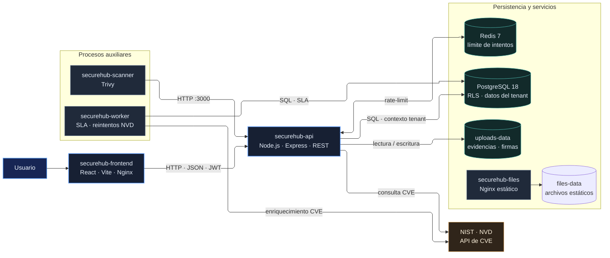
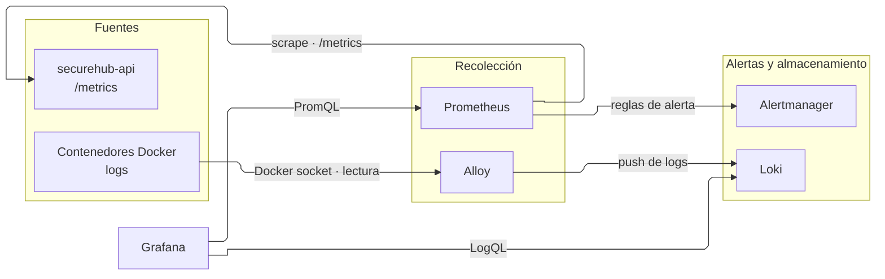
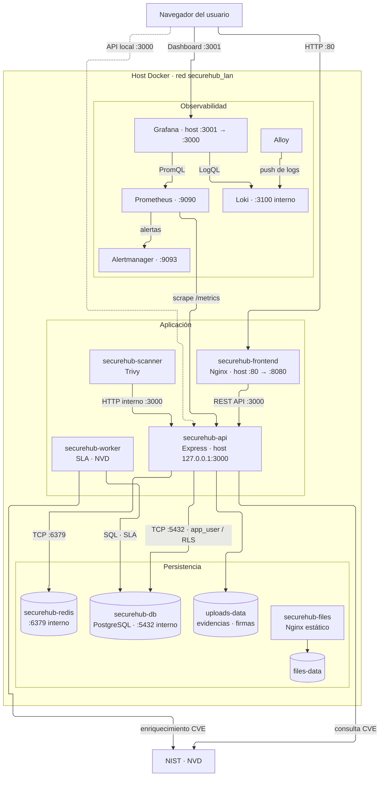
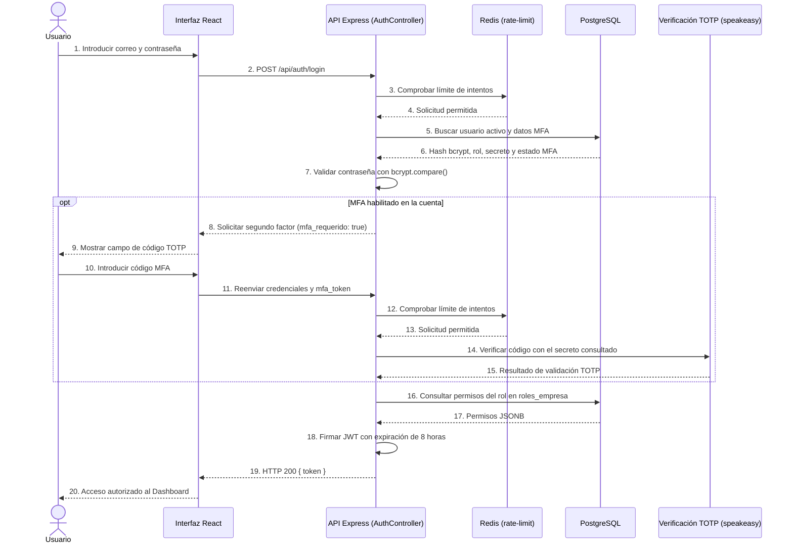
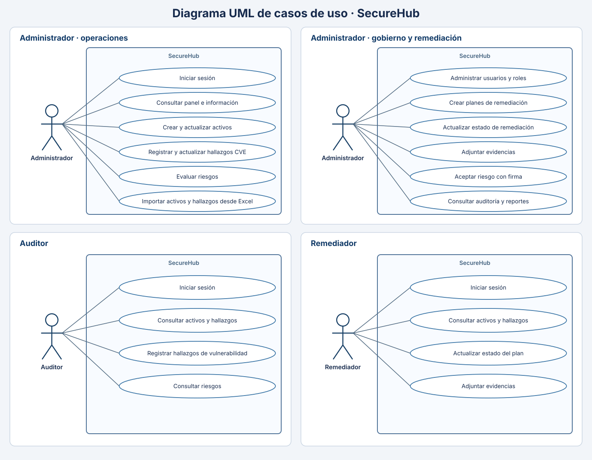
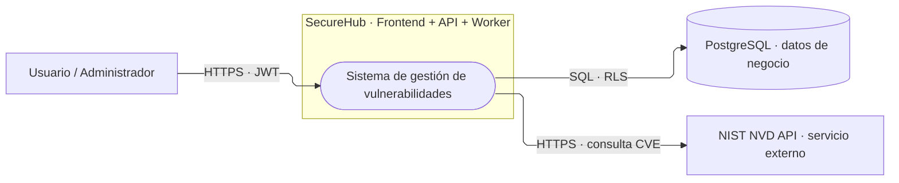
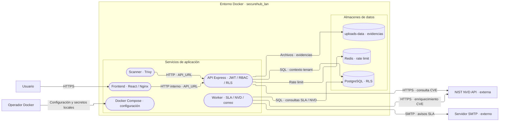
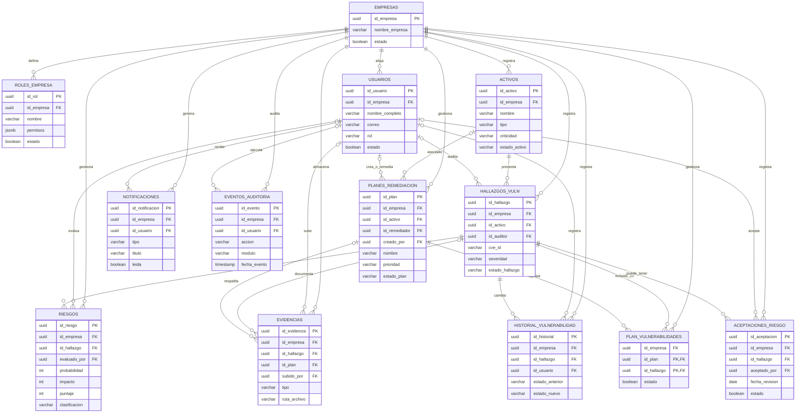

# 4.2 Manual de Arquitectura — SecureHub / VulnTrack

| Campo | Valor |
| --- | --- |
| **Proyecto** | SecureHub / VulnTrack |
| **Subtítulo** | Plataforma de Gestión de Vulnerabilidades y Riesgos |
| **Licencia seleccionada** | MIT (`LICENSE`) |
| **Versión documental** | 1.0 — Octubre de 2026 |

---

## 1. Propósito y alcance

SecureHub / VulnTrack es una plataforma web multi-inquilino (multi-tenant) contenerizada para registrar activos tecnológicos, gestionar hallazgos de vulnerabilidad enriquecidos con CVE/NVD, evaluar el riesgo asociado y hacer seguimiento automatizado a los planes de remediación y sus SLAs.

La arquitectura separa la interfaz de usuario, la API REST, el worker asíncrono, el escáner, el servidor estático de evidencias y la observabilidad en contenedores independientes orquestados con Docker Compose (`docker-compose.yml`), mientras que PostgreSQL aplica aislamiento estricto por empresa mediante Row-Level Security (RLS) a nivel de motor.

---

## 2. Visión general de la arquitectura y componentes

| Componente | Tecnología | Servicio Compose | Responsabilidad |
| --- | --- | --- | --- |
| **Frontend** | React 19 + Vite, Tailwind CSS v4, Lucide React, Recharts, Nginx | `securehub-frontend` (`:80 -> :8080`) | SPA publicada en el puerto 80; consume la API REST con autenticación JWT Bearer. |
| **Backend / API** | Node.js + Express 4, `helmet`, `cors`, `pg`, `jsonwebtoken`, `bcryptjs`, `speakeasy` | `securehub-api` (`127.0.0.1:3000 -> :3000`) | Autenticación JWT + MFA TOTP, RBAC dinámico, lógica de negocio, proxy controlado a NVD y endpoints REST documentados con OpenAPI/Swagger. |
| **Worker asíncrono** | Node.js + `node-cron` (`src/workers/worker.js`) | `securehub-worker` | Proceso independiente para monitoreo automático de vencimiento de SLAs, reintentos de enriquecimiento NVD y notificaciones. |
| **Base de datos** | PostgreSQL 18 (`postgres:18.6-alpine`) + `pgcrypto` | `securehub-db` (`:5432` interno) | Persistencia relacional, integridad referencial, UUIDs criptográficos y aislamiento multi-tenant mediante políticas RLS sobre el usuario restringido `app_user`. |
| **Caché / Rate-limit** | Redis 7 (`redis:7-alpine`) | `securehub-redis` (`:6379` interno) | Almacenamiento de contadores de limitación de intentos de inicio de sesión anti fuerza bruta. |
| **Servidor estático** | Nginx (`nginx:alpine`) | `securehub-files` | Sirve archivos desde `files-data` con configuración endurecida. Este volumen es independiente de `uploads-data`, donde la API guarda evidencias y firmas. |
| **Escáner** | Node.js + Trivy (`./scanner`) | `securehub-scanner` | Escaneo programado de componentes del repositorio y envío de hallazgos a la API. |
| **Observabilidad** | Prometheus, Alertmanager, Grafana, Loki y Alloy | `prometheus`, `alertmanager`, `grafana`, `loki`, `alloy` | Recolección de métricas (`:9090`), gestión de alertas (`:9093`), dashboards (`:3001`) y centralización de logs de contenedores. |

---

## 3. Diagramas UML y DFD requeridos

### 3.1 Diagrama de Componentes de la Aplicación

El diagrama separa la interfaz, la API, los procesos asíncronos y los servicios de datos. Las flechas indican llamadas o dependencias reales del sistema.

### 3.2 Diagrama de Observabilidad

Métricas y registros siguen recorridos independientes: Prometheus consulta la API, mientras Alloy recoge los logs de Docker y los envía a Loki. Grafana consulta ambas fuentes.

### 3.3 Diagrama de Despliegue

El límite agrupa los contenedores de la red Docker. Las conexiones del navegador muestran los puertos publicados; las demás flechas son tráfico interno entre servicios.

| Servicio | Volúmenes persistentes |
|---|---|
| `securehub-db` | `postgres-data`, `backups-data` |
| `securehub-redis` | `redis-data` |
| `securehub-files` | `files-data` |
| `securehub-api` | `uploads-data`, `logs-data` |
| `securehub-scanner` | `logs-data` |
| Prometheus, Alertmanager, Grafana, Loki y Alloy | `prometheus-data`, `alertmanager-data`, `grafana-data`, `loki-data`, `alloy-data` |

### 3.4 Diagrama de Secuencia (Autenticación con MFA TOTP condicional)

Describe el inicio de sesión con validación de contraseña mediante `bcryptjs`; el segundo factor TOTP (`speakeasy`) se solicita solo si está habilitado en la cuenta. Al final se emite el token JWT con permisos RBAC:

---

### 3.5 Diagrama de Casos de Uso

El diagrama usa la notación UML: actores fuera del límite de SecureHub, casos de uso en óvalos y asociaciones sin flechas. Se divide por perfil para que las relaciones sean legibles. Los permisos reflejan los roles definidos por la aplicación.

### 3.6 Diagramas de Flujo de Datos (DFD Nivel 0 y Nivel 1 — OWASP Threat Dragon)

Se incluyen los dos niveles del modelo formal `security/threat-model.json`, validado en **OWASP Threat Dragon 2.6.2** y comprobado en CI. Los rectángulos representan entidades externas, los procesos tienen bordes redondeados y los cilindros representan almacenes de datos. Las flechas muestran el sentido del flujo; los límites agrupan los elementos dentro del alcance de SecureHub.

#### DFD Nivel 0 — Contexto

El nivel 0 contiene 7 celdas: el actor, la aplicación, PostgreSQL, NIST NVD y los tres flujos. Registra 3 amenazas STRIDE mitigadas: suplantación de cuenta, acceso entre empresas y alteración o lectura indebida de datos.

#### DFD Nivel 1 — Servicios y límites de confianza

El nivel 1 contiene 23 celdas: 12 elementos y 11 flujos. Registra 5 amenazas STRIDE mitigadas relacionadas con autenticación, denegación de servicio, auditoría, aislamiento multiempresa y modificación de datos. `security/threat-model.json` conserva el modelo editable y sus detalles de mitigación.

## 4. Modelo relacional de datos (ERD) y decisiones de diseño

El esquema relacional definido en `base_datos/init.sql` y sus migraciones (`02-migration-v2.sql` a `05-migration-v5.sql`) se estructura en torno al aislamiento multi-tenant por `id_empresa`:

### Decisiones clave de arquitectura de datos

* **Aislamiento nativo por Row-Level Security (RLS):** Las políticas de PostgreSQL comparan `id_empresa::text` contra la variable de sesión `app.current_tenant` establecida mediante `set_config('app.current_tenant', $1, true)`.
* **Principio de mínimo privilegio (`app_user`):** El contenedor `securehub-api` y `securehub-worker` operan con el rol `app_user` (creado en `00-create-app-user.sh`), nunca como superusuario `postgres`, garantizando que las políticas RLS sean aplicadas de forma obligatoria por el motor.
* **UUIDs criptográficos:** Uso de `gen_random_uuid()` (`pgcrypto`) para impedir ataques de enumeración secuencial (IDOR).
* **Borrado lógico (Soft Delete):** Preservación de integridad histórica y trazabilidad mediante columnas de estado en lugar de borrado físico.
* **Bitácora de auditoría (`eventos_auditoria`):** Registro de eventos de negocio y seguridad con detalles en formato `JSONB`, dirección IP de origen y marca de tiempo.
